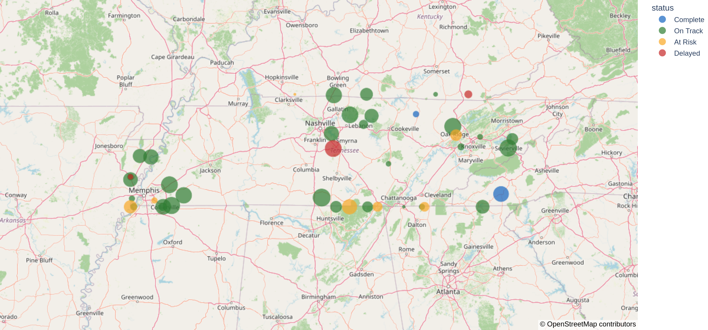
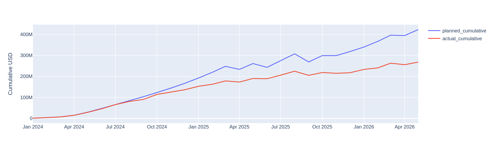

# Transportation Project Controls Dashboard

A small data-management and project-controls application built around the kind of
work a DOT project coordinator does: taking raw transportation-project data and
turning it into something clear, accurate, and actionable for project managers and
leadership.

> **Data note:** Every record in this project is **synthetic** — generated by a
> script for demonstration purposes. It is **not affiliated with, sourced from, or
> representative of any real state department of transportation data.**

---

## The problem

Transportation programs run dozens of projects at once — each with a budget, a
schedule, a phase, and a location. The information usually lives in scattered
spreadsheets, which makes it slow to answer simple questions: *What's at risk? Are
we on budget? Which region is behind?* And before any of it reaches leadership, it
needs to be **correct**.

## The approach



This app loads a portfolio of projects and provides one place to:

- **Track project controls** — phase, % complete, status, and a schedule-slip flag
  (forecast end vs. planned end).
- **Monitor budgets and trends** — planned vs. spent vs. remaining, plus a program
  burn trend (planned vs. actual spend over time).

  
- **See the work geographically** — an interactive Tennessee map, colored by status
  and sized by budget.
- **Track deliverables and submittals** — a submittal log with review due dates,
  review status, an overdue flag, and evaluation scores, the core of day-to-day
  deliverable tracking on an oversight team.
- **Catch bad data first** — a validation gate flags missing fields, impossible
  dates, out-of-range values, duplicate IDs, and budget/status mismatches before
  anything is reported.
- **Generate standardized reports** — the same data in two audience-specific views:
  a one-page executive rollup and a detailed PM report, each downloadable.

## The result

A working prototype that demonstrates the full loop — **ingest → validate →
analyze → visualize → report** — for a transportation project portfolio.

---

## Run it locally

```bash
pip install -r requirements.txt
python data/generate_data.py      # creates the synthetic CSVs
streamlit run src/app.py
```

## Project structure

```
transportation-project-controls-dashboard/
├── data/
│   ├── generate_data.py       # synthetic data generator (seeded, reproducible)
│   ├── projects.csv           # the portfolio (one row per project)
│   ├── budget_snapshots.csv   # monthly planned vs. actual spend, for trends
│   └── deliverables.csv       # submittal log: reviews, due dates, scores
├── images/
│   ├── map_overview.png       # README screenshot: status/budget map
│   └── budget_trend.png       # README screenshot: planned vs. actual burn
├── src/
│   ├── app.py                 # Streamlit dashboard (map, controls, budget, QA, reports)
│   ├── validation.py          # data-quality rules + severity rollup
│   └── reports.py             # executive + PM report generation
├── docs/
│   └── feature_checklist.md   # every feature mapped to the role's requirements
├── requirements.txt
└── README.md
```

## Data dictionary (projects.csv)

| Field | Meaning |
|---|---|
| `project_id` | Unique project identifier (`PRJ-<year>-<n>`) |
| `route` / `county` / `region` | Location and region |
| `project_type` | Resurfacing, Bridge Replacement, Interchange, etc. |
| `phase` | Planning → Design → Right-of-Way → Construction → Closeout |
| `status` | On Track / At Risk / Delayed / Complete (derived from schedule + budget) |
| `pct_complete` | 0–100 |
| `start_date` / `planned_end_date` / `forecast_end_date` | Schedule baseline vs. forecast |
| `budget` / `spent_to_date` | Financials, in USD |
| `latitude` / `longitude` | For the map |

> The generator intentionally injects five data-quality issues (an out-of-range
> percentage, an impossible date, a missing PM, an over-budget project still marked
> on track, and a duplicate ID) so the validation gate has real problems to catch.

## Skills demonstrated

Python · pandas · data validation & governance · project controls (schedule &
budget variance) · geospatial visualization · standardized reporting · Streamlit ·
Plotly · clear documentation for non-technical audiences.
